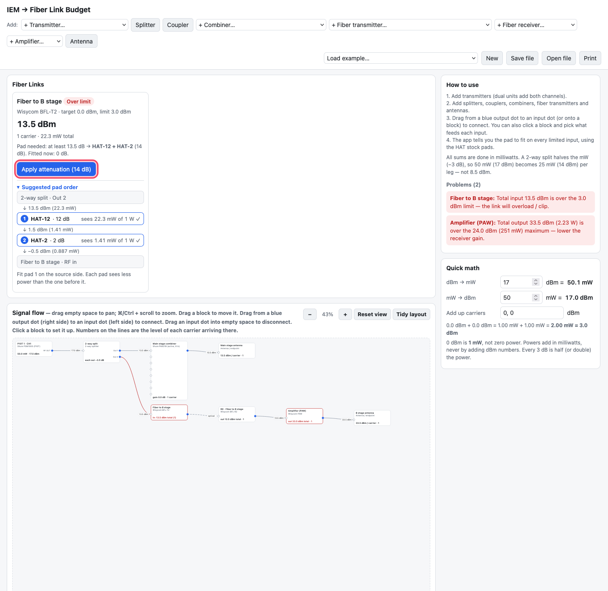
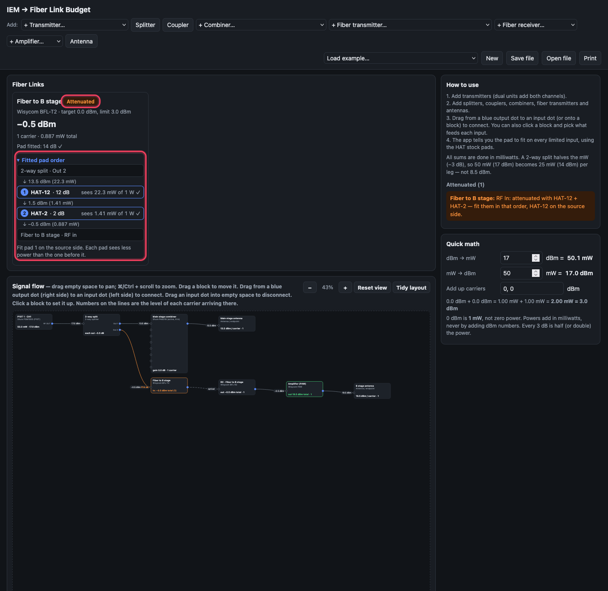
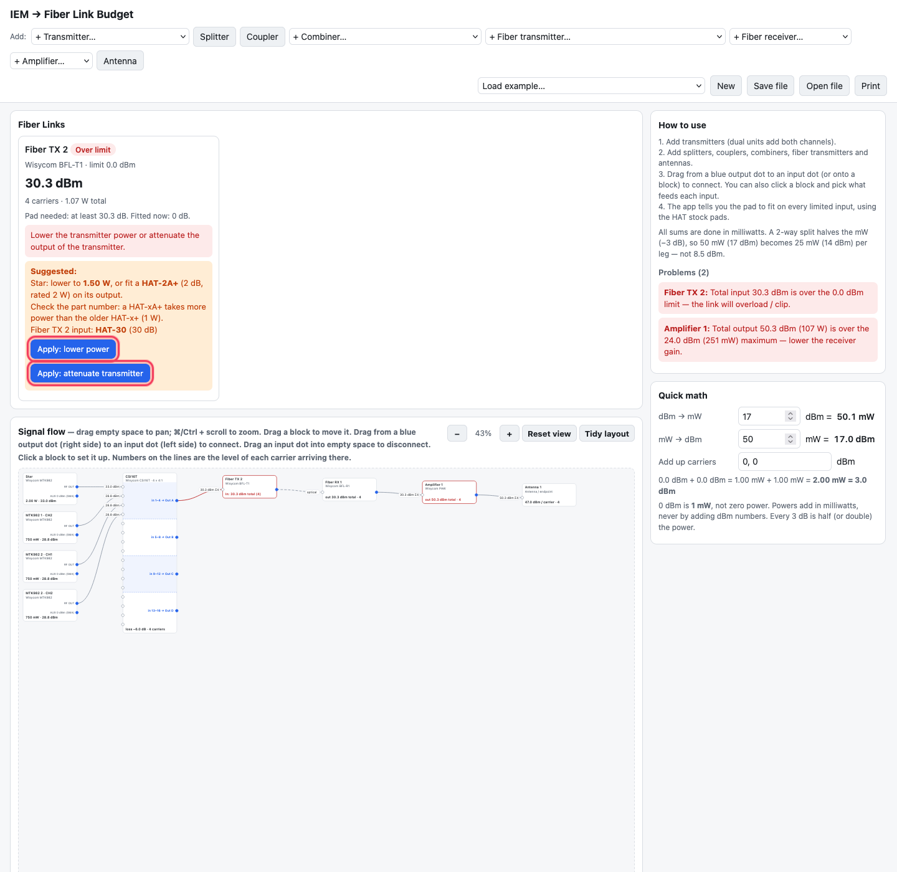
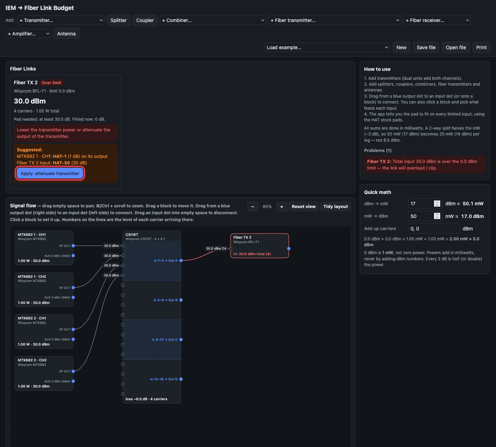
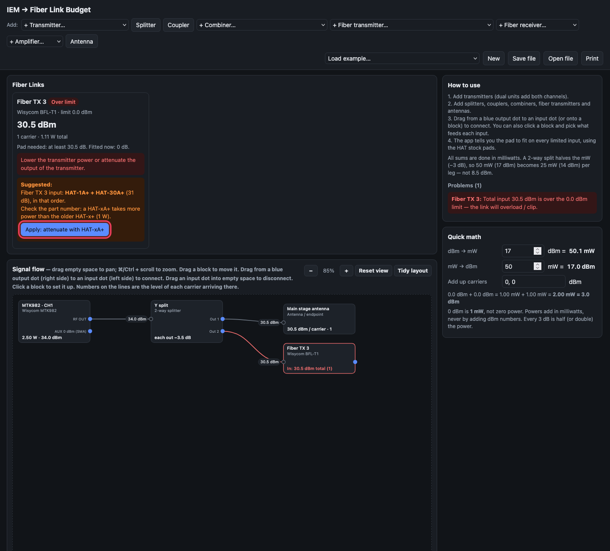
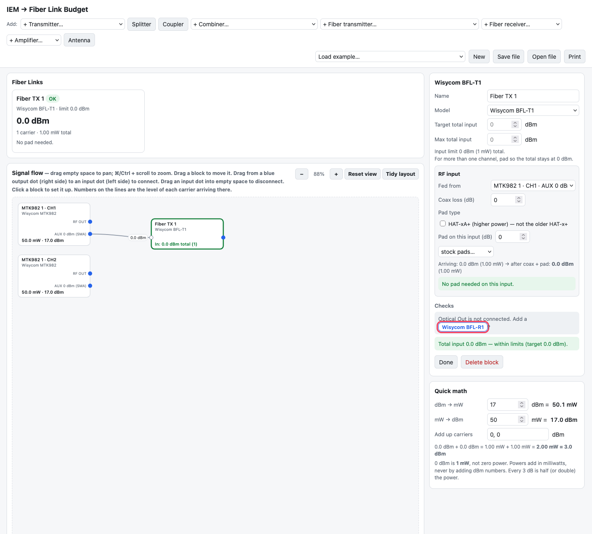
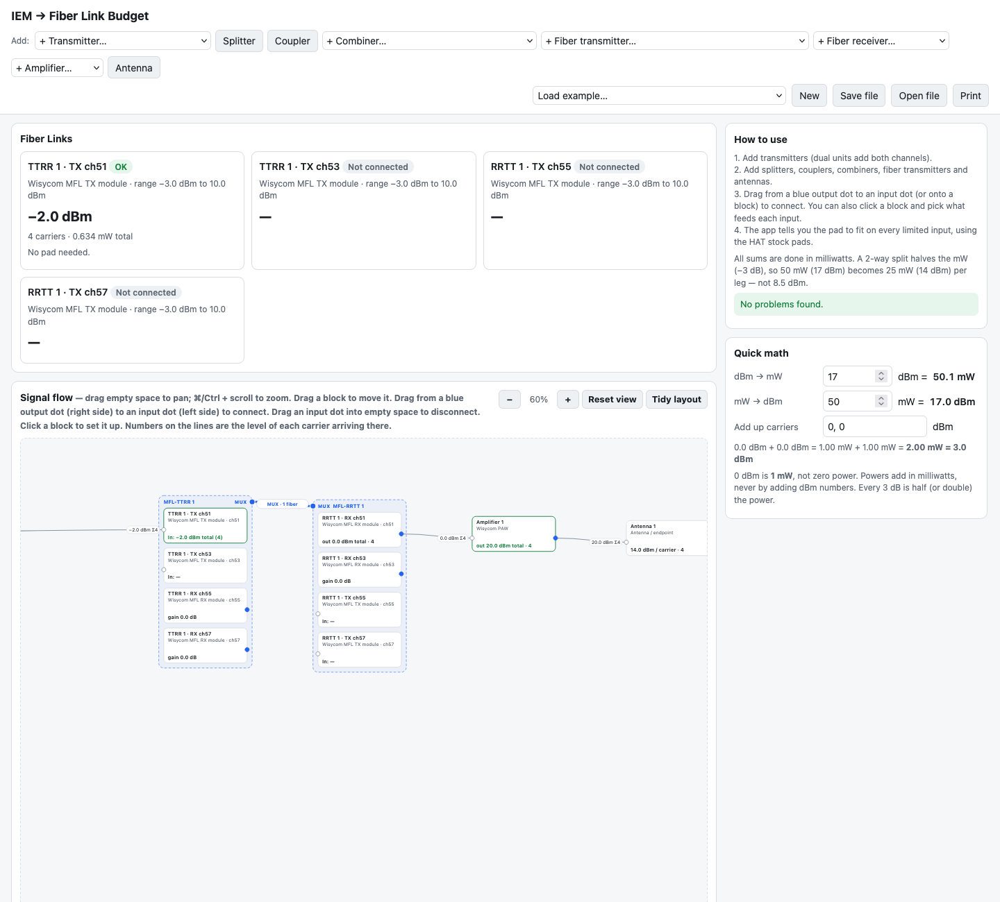

# IEM Fiber Link Budget

A link-budget calculator for in-ear monitor (IEM) transmitters feeding RF-over-fiber links.
Build the signal flow — transmitters, splitters, couplers, combiners, fiber transmitters and
receivers, amplifiers, antennas — and the app works out the level at every point and tells you
exactly which attenuators to fit, in which order, so nothing is overdriven.

It is one HTML file. It runs in any web browser, needs no internet connection and no install
beyond copying the folder.

## Install and run on a Mac

1. Download this repository (green **Code** button → **Download ZIP**) and unzip it, or
   `git clone` it.
2. Double-click **`install-mac.command`**. It copies the app to
   `~/Applications/IEM Fiber Link Budget` and puts an **IEM Fiber Link Budget** launcher on
   your Desktop.
3. Double-click the Desktop launcher (or **`run-mac.command`** in the folder) to open the app
   in your default browser.

The first time, macOS may say the script is from an unidentified developer. Right-click the
`.command` file, choose **Open**, then **Open** again. After that it opens with a double-click.

You can also just open `index.html` in a browser — the scripts are a convenience.

Designs are saved automatically in your browser. Use **Save file** / **Open file** to move a
design between computers, and **Print** for a paper copy.

## The maths

- **0 dBm is 1 mW, not zero power.** Every sum is done in milliwatts:
  0 dBm + 0 dBm = 1 mW + 1 mW = 2 mW = **+3.0 dBm**.
- A 2-way split halves the **milliwatts** (−3 dB), not the dBm number:
  50 mW (17 dBm) becomes 25 mW (14 dBm) per leg, about 13.5 dBm with real splitter loss.
- Fiber transmitter limits apply to the **total** of all carriers on the link. With four
  carriers, each one must be 6 dB below the total.
- Every attenuator is treated as the older **HAT-x+ at 1 W** for a safety margin. The newer
  HAT-xA+ parts take more power; tick **HAT-xA+** on an input to use their ratings, and check
  the part number on the pad.

## Screenshots

Each shot outlines (in red) the **Fiber Links** quick buttons it shows. The app follows your
Mac's light or dark setting; the shots are in dark mode.

**Over the limit — one click to fit the pad.** A 50 mW P10T split two ways into a BFL-T2.
The card says how much pad is needed, offers **Apply attenuation**, and the
**Suggested pad order** drop-down shows each pad, the power it sees and the level after it.

**Attenuated.** After applying, the link is at target. Stacked pads show the orange
**Attenuated** status with the fitting order — pad 1 goes on the source side.

**Too much power for a 1 W pad after a combiner — two ways to fix it.** Four MTK982s into a
CSI16T in 4 × 4:1, one of them at 2 W. **Apply: lower power** turns that transmitter down;
**Apply: attenuate transmitter** keeps its power and fits a HAT-xA+ on its output. Either way
the larger pad then goes on the fiber input.

**Pad the transmitter output instead of the fiber input.** All four at 1 W: the combined
1 W after the combiner is too much for one 1 W pad, so the app moves a small pad to the
loudest transmitter's output and keeps the big pad on the fiber input.

**Y split off one transmitter.** A 2.5 W MTK982 split between the main-stage antenna and a
BFL-T1. The main stage keeps full power; the fiber leg gets a HAT-xA+ stack with
**Apply: attenuate with HAT-xA+**.

**Quick add.** Missing pieces are offered as one-click buttons — here
*Optical Out is not connected. Add a Wisycom BFL-R1?*

**Wisycom MFL-TTRR and MFL-RRTT.** Each chassis is added on its own; drag MUX to MUX to run
ch51/53 one way and ch55/57 back on one fiber.

## Equipment included

| Kind | Models |
|---|---|
| IEM transmitters | Shure PSM1000 (P10T), PSM900 (P9T), Axient Digital PSM ADTD / ADTQ; Sennheiser SR 2000 / SR 2050; Wisycom MTK952 (with and without M/S), MTK982; Lectrosonics M2T, IFBT20, IFBT4, IFBT4-VHF |
| Combiners | Shure PA821B, PA421B, PA411, AD8C (2 × 4:1, 8:1), AD221; Sennheiser AC 3200-II (+ High Gain); Wisycom CSI16T (16:1, 2 × 8:1, 4 × 4:1); Mini-Circuits ZAPD-1+; Lectrosonics M2C-L; RF Venue COMBINE4, COMBINE6 HDR, COMBINE8, 2X1 SPLIT; generic active / passive |
| Splitters | Mini-Circuits ZAPD-1+ (2-way, 10 W); Wisycom CSI16T in reverse (16-, 8- or 4-way); generic 2 / 3 / 4 / 8-way |
| Directional couplers | Mini-Circuits ZFDC-20-4+, ZFDC-20-5+, ZFBDC20-13HP+, ZFBDC20-62HP+, ZFDC-20-1H+ (20 dB); ZFDC-10-2, ZFDC-10-21, ZFDC-10-5+, ZFDC-10-182+, ZFDC-10-1+ (10 dB); generic |
| Fiber transmitters | Wisycom BFL-T2, BFL-T1, MFL, MFL-TTRR / MFL-RRTT chassis; RF Venue Optix (Series 2, Series 3); PWS PRZM T1 |
| Fiber receivers | Wisycom BFL-R2, BFL-R1, MFL RX; RF Venue Optix; PWS PRZM R1 |
| Amplifiers | Wisycom PAW-L, PAW-H, PAW-V, MPA4-BL, MPA4-BH; two-input Combiner/Amplifier (passive or active inputs, up to 5 W); generic |
| Attenuators | Mini-Circuits HAT-1 … HAT-30 (HAT-x+ at 1 W, HAT-xA+ at their rated power) |

Figures come from the manufacturers' manuals and spec sheets. Always confirm against the
documentation for your exact model, band and firmware.

## License

MIT — see [LICENSE](LICENSE).
